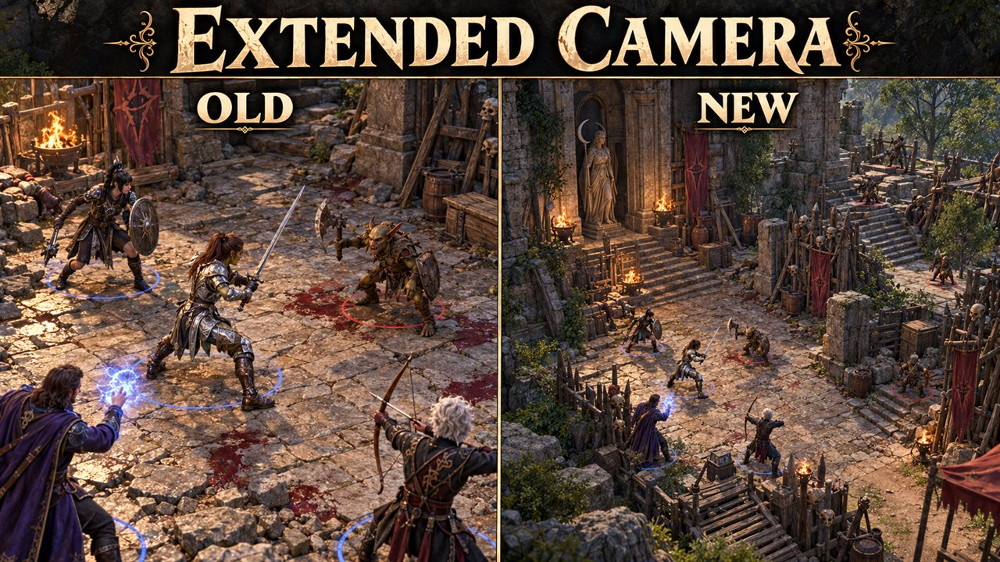

# Extended Camera

Lets the camera zoom out further and move further from your character than the game allows.

## What it does

- The camera zooms out further: up to 20 instead of 12 when you explore, and up to 20 instead of 15 in combat.
- The camera can move further away from your character when you pan it: up to 60 instead of 50.
- Sliders in the Mod Configuration Menu set the zoom limits (10 to 40) and the move range (10 to 200). A change
  applies at once, without a reload.
- The tactical view (the overhead camera) and the controller camera keep the game's own limits.
- A small Lua script for the Script Extender: no DLL, no changed game files, and nothing in your savegame.

## Screenshots

## How to install

1. Install [Norbyte's Script Extender](https://github.com/Norbyte/bg3se). It updates itself.
2. Install the [Mod Configuration Menu](https://github.com/KintaroModding/bg3_mcm/releases/latest), version 1.41 or
   later. The official Mod Configuration Menu 1.41 or later works too; keep only one of them.
3. Download `bg3_extendedcamera.pak` from the latest release on GitHub.
4. Copy it to `%LOCALAPPDATA%\Larian Studios\Baldur's Gate 3\Mods`.
5. Enable **Extended Camera** in your mod manager (BG3 Mod Manager or the in-game mod manager), below the Mod
   Configuration Menu.

To update the mod, replace the `.pak` with the one from the new release. To remove it, disable it in the mod manager
and delete the `.pak`. Saves made with the mod can then show a warning about a missing mod.

## How to use

- Open the Mod Configuration Menu (main menu, Esc menu, or the Insert key) and select **Extended Camera**.
- **Max zoom-out when exploring** (default 20; the game uses 12): how far the camera can zoom out outside combat.
- **Max zoom-out in combat** (default 20; the game uses 15): the same during combat.
- **Camera move range** (default 60; the game uses 50): how far the camera can move away from your character when you
  pan it with the keys, the mouse or the screen edge. The camera slows down shortly before the limit, as in the game.
- Zoom and pan as usual. A changed value applies at once. Set a slider to the game's value to get the normal camera
  back.
- The Mod Configuration Menu stores the settings in its profile, not in the savegame.

## Compatibility

- Game version: Patch 8
- The mod stores nothing in your savegame: you can add or remove it at any time.
- Other mods that change the camera's zoom limit or move range, for example Native Camera Tweaks with its zoom
  override, conflict with this one. Use only one of them for these limits.

## Known issues

- With a far camera, the view can go above the ceiling indoors.

## How to build

Anyone can build this mod from its source code and check that the download matches it.

1. Install the tools: Windows PowerShell 5.1 (part of Windows) and [LSLib](https://github.com/Norbyte/lslib/releases)
   v1.20.4. Put LSLib into a folder `_tools\lslib\` above the repository, or set `BG3_TOOLS` to the folder that holds
   `lslib\`.
2. Build it: `powershell -ExecutionPolicy Bypass -File .\build.ps1`
3. Find the file: `dist\bg3_extendedcamera.pak`

The offline tests need Python 3 with lupa: `python -m pip install lupa`, then `python tests\run_tests.py`.

## Credits

Made by Kintaro. MIT license: you may use, change and share this mod.

Thanks to ersh1 for [Native Camera Tweaks](https://github.com/ersh1/BG3_NativeCameraTweaks): its source showed which
camera values hold the zoom limits, and the game's own values. This mod copies no code from it. Thanks to Norbyte for
the [Script Extender](https://github.com/Norbyte/bg3se), which gives Lua access to these values.
